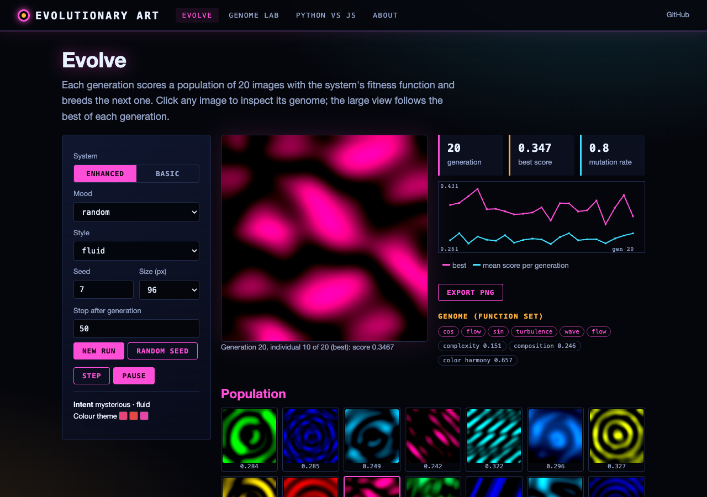
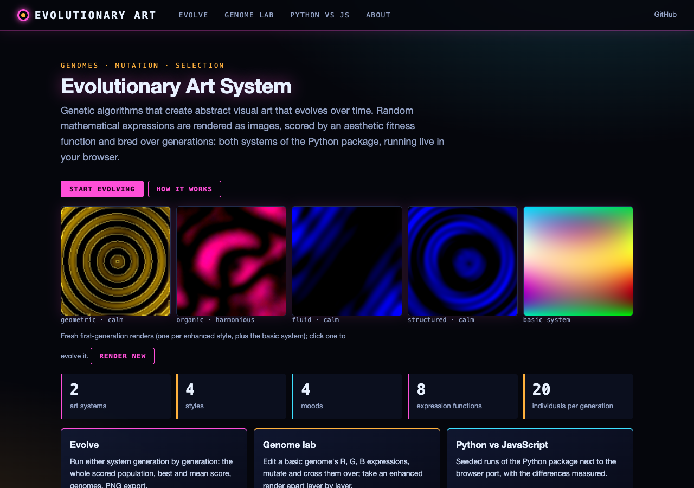
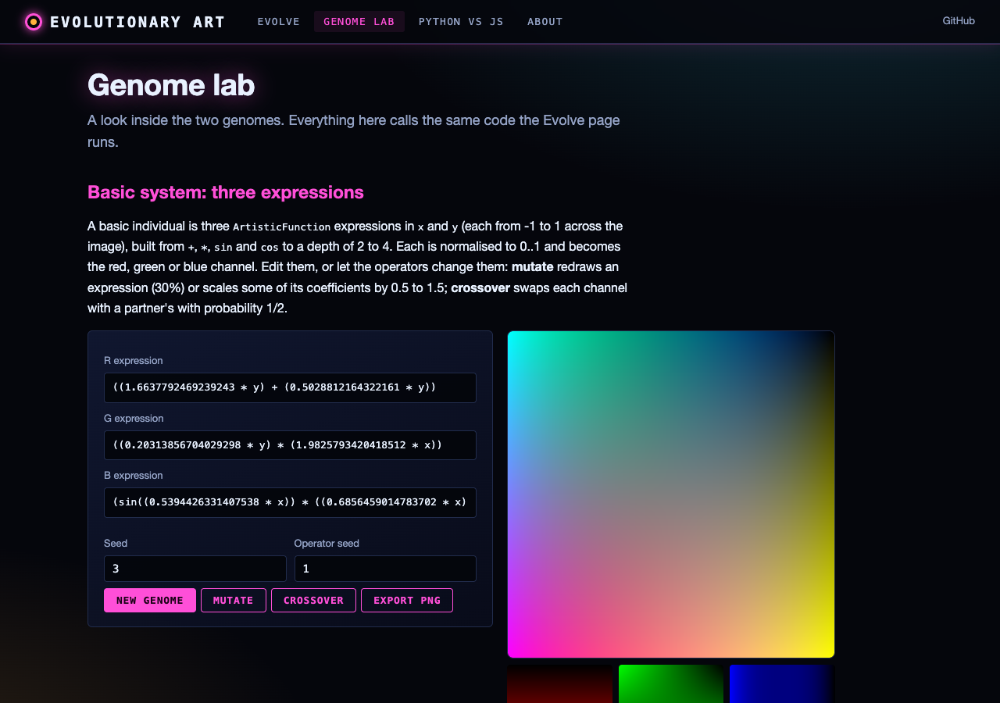
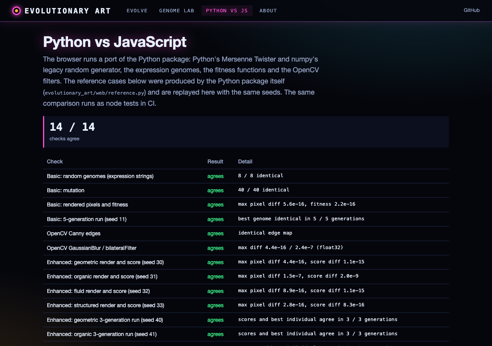

# Computational Art Evolution Systems

This repository contains two evolutionary art generation systems that explore different approaches to computational creativity. These systems use genetic algorithms and mathematical functions to create abstract visual art that evolves over time.

## Overview

The `evolutionary_art` package contains two systems:
1. Basic Evolutionary Art System (`EvolutionaryArtSystem` in `evolutionary_art/core.py`)
2. Enhanced Art System (`EnhancedEvolutionaryArt` in `evolutionary_art/rendering.py`)

The original single-file scripts they were refactored from are kept in `_archive/`.

Both systems demonstrate different approaches to computational creativity, with the enhanced system building upon the foundations of the basic system to create more diverse and dramatic results.

## Features

### Basic Evolutionary Art System
- Generates art using mathematical functions and color theory
- Uses genetic algorithms to evolve artistic patterns
- Implements basic aesthetic measures
- Focuses on mathematical patterns and color harmony

### Enhanced Art System
- More sophisticated evolutionary algorithms
- Dynamic mutation rates
- Multiple artistic styles (geometric, organic, fluid, structured)
- Multiple moods (calm, energetic, mysterious, harmonious)
- Advanced layer combinations and transformations
- Style-specific visual effects
- More dramatic color variations
- Coordinate system transformations

## Installation

### Prerequisites
- Python 3.7 or higher
- pip package manager

### Required Libraries
```bash
pip install -r requirements.txt
```
(numpy, Pillow, deap and opencv-python are used; without OpenCV the enhanced system skips its style effects.)

## Usage

### Command line
```bash
python -m evolutionary_art --mode enhanced --style geometric --mood calm --generations 50 --size 800 --seed 1
python -m evolutionary_art --mode basic --generations 50 --output-dir evolution_output
```

### Basic System
```python
from evolutionary_art import EvolutionaryArtSystem
art_system = EvolutionaryArtSystem(width=800, height=800, seed=1)
art_system.evolve_art()
```

### Enhanced System
```python
from evolutionary_art import EnhancedEvolutionaryArt
art_system = EnhancedEvolutionaryArt(width=800, height=800, seed=1, mood="calm", style="fluid")
art_system.evolve()
```

Both systems will create an `evolution_output` directory containing generated artwork from each generation.

## Web interface and live site

**Live site:** https://gddickinson.github.io/evolutionart-art-system/ (static GitHub Pages build; both systems run in
your browser).



| Home | Genome lab | Python vs JS |
|------|------------|--------------|
|  |  |  |

- **Evolve**: run either system generation by generation, see the whole scored population, best and mean score per
  generation, each individual's genome and fitness terms; export PNGs.
- **Genome lab**: edit, mutate and cross over a basic genome; trace one enhanced render (expressions, blends, tint,
  style effect, score terms).
- **Python vs JS**: the JavaScript port replays seeded reference runs of this package and shows the differences
  (bit-identical random streams and genomes; pixels and scores within floating-point rounding).

### Run the web app

```bash
pip install -r requirements-web.txt
python run_web.py            # http://127.0.0.1:8158
```

The local app also runs the Python package itself (Python vs JS page). Tests: `python -m pytest -q tests/
test_evolutionary_art.py` (includes the node tests of the JS port). Build the static site with
`python scripts/build_static.py`; it is published by `.github/workflows/pages.yml` on every push to `main`
(one-time setup: Settings -> Pages -> Source: GitHub Actions).

## Technical Details

### Basic System Architecture

The basic system uses:
- Mathematical function generation
- Color space transformations
- Basic genetic algorithms
- Simple aesthetic measures

Key components:
1. Function Generation
   - Random mathematical expression creation
   - Basic operators (+, *, sin, cos)
   - Parameter space exploration

2. Evolution Process
   - Population management
   - Crossover operations
   - Simple mutation strategies

3. Aesthetic Evaluation
   - Color harmony
   - Pattern complexity
   - Basic composition rules

### Enhanced System Architecture

The enhanced system adds:

1. Artistic Intent
   - Mood selection
   - Style determination
   - Color theme generation
   - Composition weight calculation

2. Advanced Function Generation
   - Multiple layer support
   - Coordinate transformations
   - Complex mathematical operations
   - Style-specific functions

3. Sophisticated Evolution
   - Adaptive mutation rates
   - Tournament selection
   - Population diversity maintenance
   - Generation improvement tracking

4. Enhanced Visualization
   - Multi-layer composition
   - Style-specific effects
   - Advanced color manipulation
   - Texture and pattern generation

### Key Algorithms

1. Function Generation
```python
def generate_expression(self):
    complexity = 3 if self.intent.mood == 'energetic' else 2
    return self._build_expression(complexity)
```

2. Layer Combination
```python
# Example of layer combination
for layer in layers[1:]:
    op = random.choice(['add', 'multiply', 'difference'])
    if op == 'add':
        combined = (combined + layer) / 2
    elif op == 'multiply':
        combined = combined * layer
    else:
        combined = np.abs(combined - layer)
```

## Artistic Considerations

### Basic System
- Focuses on mathematical beauty
- Explores pattern emergence
- Uses color theory principles

### Enhanced System
- Incorporates artistic intent
- Explores multiple artistic styles
- Considers mood and atmosphere
- Creates more dramatic variations
- Uses advanced composition techniques

## Development Process

Both systems were developed through iterative experimentation with:
- Mathematical function generation
- Genetic algorithm parameters
- Aesthetic evaluation metrics
- Visual effect combinations
- Color space manipulations

The enhanced system represents a significant evolution in approach, moving from purely mathematical patterns to more intentional artistic creation.

## Future Enhancements

Potential areas for future development:
- Interactive evolution with user feedback
- Neural network-based aesthetic evaluation
- More sophisticated color theory implementation
- Additional artistic styles and moods
- 3D geometry support
- Animation capabilities
- Sound-visual synchronization
- Real-time evolution visualization

## Contributing

Contributions are welcome! Please feel free to submit pull requests. For major changes, please open an issue first to discuss what you would like to change.

Areas particularly open for contribution:
- New artistic styles
- Additional mathematical functions
- Improved aesthetic measures
- Performance optimizations
- User interface development
- Documentation improvements

## License

This project is released under the MIT License. See LICENSE file for details.

## Acknowledgments

- Created with assistance from Anthropic's Claude AI
- Inspired by natural evolution and artistic processes
- Built on principles of computational creativity
- Influenced by generative art pioneers

## Support

For questions, issues, or feature requests, please open an issue on the GitHub repository.

---

*Note: This project demonstrates the potential of computational systems to create unique artistic expressions through evolutionary algorithms and mathematical patterns.*